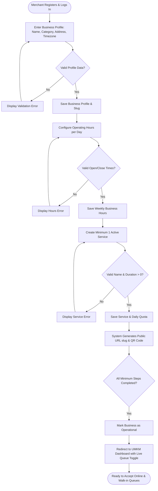
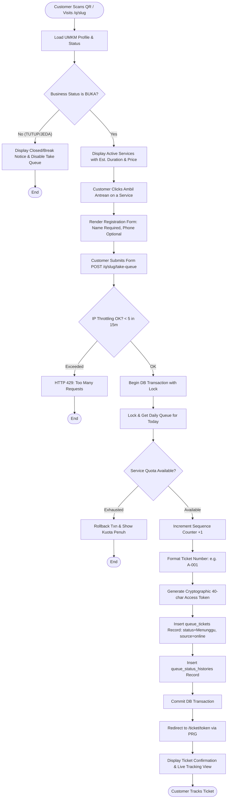
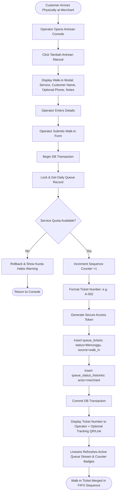
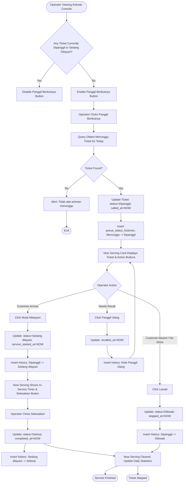
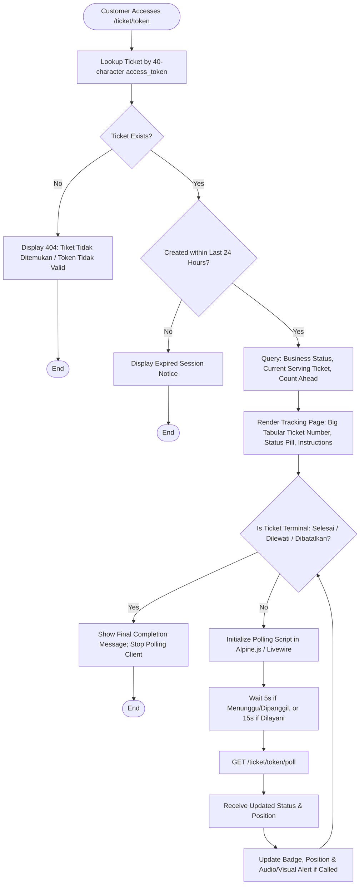
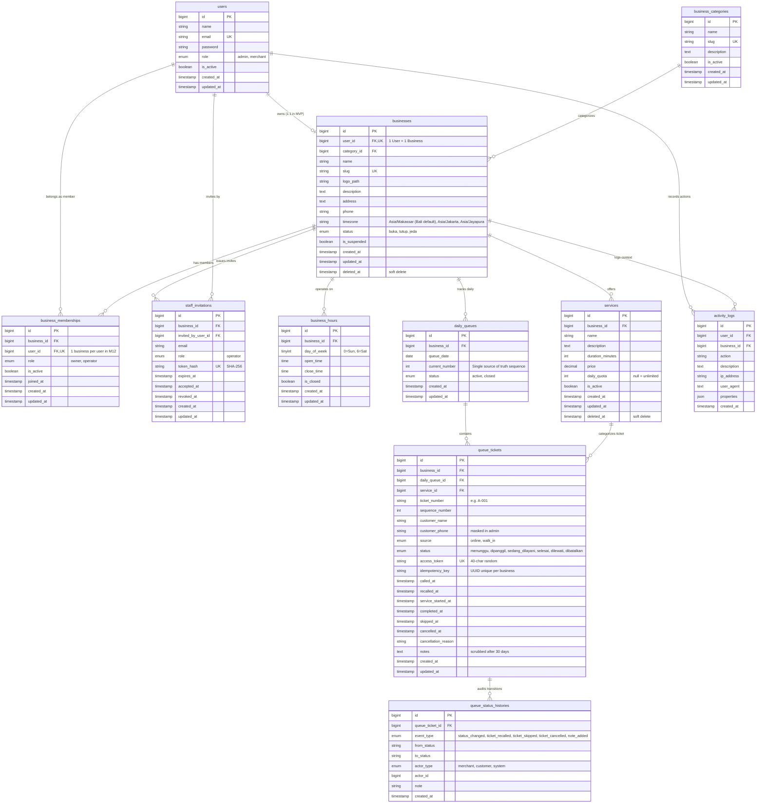

# AntreIn — System Modeling, Diagrams, ERD & Data Dictionary

> **Document Status:** Milestone 1 Architecture & Design Baseline  
> **Date:** 9 November 2026  
> **Version:** 1.0  
> **Scope:** Full-System Modeling (Admin AntreIn, Merchant UMKM, Customer)  
> **Authority References:** `AntreIn-PRD.md`, `AntreIn-design.md`, `AntreIn-Architecture-Decisions.md`

---

## 1. System Use Case Diagrams (M1-01)

### 1.1 Complete Platform Use Case Model

```mermaid
flowchart LR
    subgraph Actors
        Admin((Admin AntreIn))
        Merchant((Pemilik UMKM))
        Customer((Pelanggan))
    end

    subgraph AdminModule["Admin Platform Governance"]
        UC_A1[Platform Dashboard & Metrics]
        UC_A2[Manage UMKM Accounts & Status]
        UC_A3[Manage Platform Users]
        UC_A4[Cross-Merchant Queue Monitoring - Read Only]
        UC_A5[Manage Business Categories]
        UC_A6[Configure Platform Settings]
    end

    subgraph MerchantModule["Merchant Operational Desk"]
        UC_M1[Register, Login & Forgot Password]
        UC_M2[Complete Business Onboarding]
        UC_M3[Configure Profile & Timezone]
        UC_M4[Configure Operating Hours & Schedule]
        UC_M5[CRUD Services & Daily Quotas]
        UC_M6[Operational Queue Console]
        UC_M7[Call Next Ticket - FIFO]
        UC_M8[Recall Ticket]
        UC_M9[Start Service]
        UC_M10[Complete Service]
        UC_M11[Skip Ticket - No Show]
        UC_M12[Cancel Ticket - Menunggu Only]
        UC_M13[Add Manual Walk-In Ticket]
        UC_M14[View Operational Reports & Analytics]
        UC_M15[Access & Share Public QR / Link]
    end

    subgraph CustomerModule["Customer Frictionless Experience"]
        UC_C1[View UMKM Info & Catalog]
        UC_C2[Select Service & Fill Name]
        UC_C3[Take Queue Ticket Online]
        UC_C4[View Ticket Confirmation]
        UC_C5[Track Live Status via Private Token]
        UC_C6[Poll Queue Position & Call Status]
    end

    Admin --> UC_A1
    Admin --> UC_A2
    Admin --> UC_A3
    Admin --> UC_A4
    Admin --> UC_A5
    Admin --> UC_A6

    Merchant --> UC_M1
    Merchant --> UC_M2
    Merchant --> UC_M3
    Merchant --> UC_M4
    Merchant --> UC_M5
    Merchant --> UC_M6
    Merchant --> UC_M7
    Merchant --> UC_M8
    Merchant --> UC_M9
    Merchant --> UC_M10
    Merchant --> UC_M11
    Merchant --> UC_M12
    Merchant --> UC_M13
    Merchant --> UC_M14
    Merchant --> UC_M15

    Customer --> UC_C1
    Customer --> UC_C2
    Customer --> UC_C3
    Customer --> UC_C4
    Customer --> UC_C5
    Customer --> UC_C6
```



---

## 2. Activity Diagrams (M1-02 to M1-06)

### 2.1 Activity Diagram: Onboarding UMKM (M1-02)



---

### 2.2 Activity Diagram: Pengambilan Antrean Online (M1-03)



---

### 2.3 Activity Diagram: Penambahan Antrean Walk-In (M1-04)



---

### 2.4 Activity Diagram: Lifecycle Pelayanan Antrean (M1-05)



---

### 2.5 Activity Diagram: Monitoring Tiket Pelanggan (M1-06)



---

## 3. Queue State Machine & Transition Rules (M1-07)

### 3.1 State Transition Matrix

| Initial State | Target: `Menunggu` | Target: `Dipanggil` | Target: `Sedang dilayani` | Target: `Selesai` | Target: `Dilewati` | Target: `Dibatalkan` |
|---|:---:|:---:|:---:|:---:|:---:|:---:|
| **`Menunggu`** | — | **VALID** (Panggil Berikutnya) | INVALID (422) | INVALID (422) | **VALID** (Lewati) | **VALID** (Dibatalkan oleh Operator) |
| **`Dipanggil`** | INVALID (422) | **VALID** (Panggil Ulang, timestamp only) | **VALID** (Mulai Melayani) | INVALID (422) | **VALID** (Lewati) | INVALID (422) |
| **`Sedang dilayani`** | INVALID (422) | INVALID (422) | — | **VALID** (Selesaikan) | INVALID (422) | INVALID (422) |
| **`Selesai` (Terminal)** | INVALID (422) | INVALID (422) | INVALID (422) | — | INVALID (422) | INVALID (422) |
| **`Dilewati` (Terminal)** | INVALID (422) | INVALID (422) | INVALID (422) | INVALID (422) | — | INVALID (422) |
| **`Dibatalkan` (Terminal)** | INVALID (422) | INVALID (422) | INVALID (422) | INVALID (422) | INVALID (422) | — |

*Strict Backend Rule:* Any request attempting an invalid transition will be intercepted by `QueueService` and throw `InvalidQueueStatusTransitionException` returning HTTP 422 with localized error message.

### 3.2 Owner Account Deactivation Interlock & Emergency Procedure
- **Normal Owner Deactivation Interlock:**
  - Before deactivating a merchant owner user (`users.is_active = false`), the system evaluates if there are any active queue tickets (`status IN ('menunggu', 'dipanggil', 'sedang_dilayani')`) belonging to that merchant's daily queue for today.
  - If active tickets exist, normal deactivation is **strictly blocked** with HTTP 422:
    `"Tidak dapat menonaktifkan akun pemilik karena masih terdapat antrean aktif. Selesaikan atau batalkan seluruh antrean terlebih dahulu."`
- **Emergency Administrative Procedure (`emergency_force`):**
  - In critical scenarios (severe fraud, legal demand, physical site emergency) where an Administrator must immediately lock out a merchant:
    1. The Admin supplies `emergency_force = true` along with an audit reason.
    2. The transaction atomically transitions all active tickets (`menunggu`, `dipanggil`, `sedang_dilayani`) to `dibatalkan` with:
       - `cancelled_at = NOW()`
       - `cancellation_reason = 'Penutupan darurat oleh administrator: ' || [reason]`
    3. The business operational status is immediately updated to `status = 'tutup'`.
    4. The user account is deactivated: `is_active = false`.
    5. An immutable security record is created in `activity_logs` documenting the Admin ID, IP address, timestamp, and affected ticket IDs.

---

## 4. Role, Permission & Data Ownership Matrix (M1-08)

### 4.1 Permission Matrix

| Module / Action | Guest / Pelanggan | Pemilik UMKM (Owner) | Admin AntreIn |
|---|:---:|:---:|:---:|
| **View Landing Page** | Allow | Allow | Allow |
| **Merchant Register / Login** | Allow | Allow | Allow |
| **Admin Login** | Deny | Deny | Allow |
| **View UMKM Public Page (`/q/{slug}`)** | Allow | Allow | Allow |
| **Take Online Queue Ticket** | Allow | Allow | Deny |
| **Track Public Ticket (`/ticket/{token}`)** | Allow (Token-bound) | Allow (Token-bound) | Deny |
| **Access UMKM Dashboard & Console** | Deny | Allow (Own Business Only) | Deny |
| **Call / Process / Complete Queue** | Deny | Allow (Own Business Only) | Deny |
| **Create Walk-in Ticket** | Deny | Allow (Own Business Only) | Deny |
| **CRUD Services & Quotas** | Deny | Allow (Own Business Only) | Deny |
| **Configure Operating Hours & Timezone** | Deny | Allow (Own Business Only) | Deny |
| **View UMKM Operational Reports** | Deny | Allow (Own Business Only) | Deny |
| **Platform Monitoring (`/admin/queues`)** | Deny | Deny | Allow (Read-Only, Masked PII) |
| **Manage UMKM Accounts & Suspend** | Deny | Deny | Allow |
| **Manage Platform Users** | Deny | Deny | Allow |
| **Manage Business Categories** | Deny | Deny | Allow |
| **Configure Platform Settings** | Deny | Deny | Allow |

### 4.2 Data Ownership Scoping
- **Tenant Scope Enforcement:** Every authenticated Merchant request is bound to their authenticated `business_id`.
- Livewire components and Controllers must never accept a `business_id` from client form inputs; it must always be resolved server-side: `auth()->user()->business->id`.
- Cross-tenant data tampering attempts trigger an immediate `403 Forbidden` response and an entry in `activity_logs`.

---

## 5. Entity-Relationship Diagram (ERD) (M1-09)



---

## 6. Comprehensive Data Dictionary (M1-10 to M1-20)

### 6.1 Table: `users` (M1-11)
Stores authenticated user accounts for Platform Admins and Merchant Owners.

| Column | Type | Nullable | Default | Index / Key | Description |
|---|---|:---:|---|---|---|
| `id` | `BIGINT UNSIGNED` | No | Auto Increment | Primary Key | Unique user record identifier. |
| `name` | `VARCHAR(255)` | No | — | — | Full name of the user. |
| `email` | `VARCHAR(255)` | No | — | Unique (`uq_users_email`) | Unique email address used for login and password reset. |
| `password` | `VARCHAR(255)` | No | — | — | Secure bcrypt hashed password (`BCRYPT_ROUNDS=12`). |
| `role` | `ENUM('admin', 'merchant')` | No | `'merchant'` | Index (`idx_users_role`) | Role determining access permissions. Admin is provisioned via seeder. |
| `is_active` | `BOOLEAN` | No | `TRUE` | — | Flag to deactivate account; deactivated users cannot log in. |
| `remember_token` | `VARCHAR(100)` | Yes | `NULL` | — | Standard Laravel remember-me authentication token. |
| `created_at` | `TIMESTAMP` | Yes | `NULL` | — | Account creation timestamp. |
| `updated_at` | `TIMESTAMP` | Yes | `NULL` | — | Account last modification timestamp. |

---

### 6.2 Table: `business_categories` (M1-12)
Stores business taxonomy created and managed by Admin AntreIn.

| Column | Type | Nullable | Default | Index / Key | Description |
|---|---|:---:|---|---|---|
| `id` | `BIGINT UNSIGNED` | No | Auto Increment | Primary Key | Unique category identifier. |
| `name` | `VARCHAR(100)` | No | — | — | Name of category (e.g. "Barbershop", "Klinik & Praktik Dokter", "Salon Kecantikan", "Kuliner & Restoran"). |
| `slug` | `VARCHAR(120)` | No | — | Unique (`uq_categories_slug`) | URL-safe slug for category reference. |
| `description` | `TEXT` | Yes | `NULL` | — | Optional description of the category scope. |
| `is_active` | `BOOLEAN` | No | `TRUE` | — | Toggle to display/hide category during merchant onboarding. |
| `created_at` | `TIMESTAMP` | Yes | `NULL` | — | Creation timestamp. |
| `updated_at` | `TIMESTAMP` | Yes | `NULL` | — | Last modification timestamp. |

---

### 6.3 Table: `businesses` (M1-12)
Stores core business profile, operational status, timezone, and public identifier.

| Column | Type | Nullable | Default | Index / Key | Description |
|---|---|:---:|---|---|---|
| `id` | `BIGINT UNSIGNED` | No | Auto Increment | Primary Key | Unique business identifier. |
| `user_id` | `BIGINT UNSIGNED` | No | — | Foreign Key, Unique (`uq_businesses_user`) | References `users.id`. Enforces 1 User = 1 Business for MVP. |
| `category_id` | `BIGINT UNSIGNED` | Yes | `NULL` | Foreign Key (`fk_businesses_category`) | References `business_categories.id`. `ON DELETE SET NULL`. |
| `name` | `VARCHAR(150)` | No | — | — | Registered trade name of the UMKM. |
| `slug` | `VARCHAR(180)` | No | — | Unique (`uq_businesses_slug`) | Public URL identifier (`/q/{slug}`). |
| `logo_path` | `VARCHAR(255)` | Yes | `NULL` | — | Storage path for uploaded merchant logo image. |
| `description` | `TEXT` | Yes | `NULL` | — | Brief promotional description of the business. |
| `address` | `TEXT` | Yes | `NULL` | — | Physical address of the venue. |
| `phone` | `VARCHAR(30)` | Yes | `NULL` | — | Contact telephone/WhatsApp number of the business. |
| `timezone` | `VARCHAR(50)` | No | `'Asia/Makassar'` | — | Merchant local timezone: `Asia/Makassar` (WITA - Bali default), `Asia/Jakarta` (WIB), `Asia/Jayapura` (WIT). |
| `status` | `ENUM('buka', 'tutup', 'jeda')`| No | `'tutup'` | Index (`idx_businesses_status`) | Manual operational switch. `buka` accepts new online tickets; `tutup`/`jeda` blocks new online tickets. |
| `is_suspended` | `BOOLEAN` | No | `FALSE` | — | Admin platform suspension flag. Suspended merchants cannot generate new tickets. |
| `created_at` | `TIMESTAMP` | Yes | `NULL` | — | Creation timestamp. |
| `updated_at` | `TIMESTAMP` | Yes | `NULL` | — | Last modification timestamp. |
| `deleted_at` | `TIMESTAMP` | Yes | `NULL` | Index (`idx_businesses_deleted`) | Soft delete timestamp preserving historical references. |

---

### 6.4 Table: `business_hours` (M1-13)
Stores weekly operating schedule for each merchant.

| Column | Type | Nullable | Default | Index / Key | Description |
|---|---|:---:|---|---|---|
| `id` | `BIGINT UNSIGNED` | No | Auto Increment | Primary Key | Unique schedule record identifier. |
| `business_id` | `BIGINT UNSIGNED` | No | — | Foreign Key (`fk_hours_business`) | References `businesses.id`. `ON DELETE CASCADE`. |
| `day_of_week` | `TINYINT UNSIGNED` | No | — | Unique (`uq_biz_day`, with `business_id`) | Day representation: `0` (Sunday) through `6` (Saturday). |
| `open_time` | `TIME` | Yes | `NULL` | — | Scheduled opening time (e.g. `09:00:00`). |
| `close_time` | `TIME` | Yes | `NULL` | — | Scheduled closing time (e.g. `17:00:00`). |
| `is_closed` | `BOOLEAN` | No | `FALSE` | — | Flag indicating whether merchant is scheduled closed on this day. |
| `created_at` | `TIMESTAMP` | Yes | `NULL` | — | Creation timestamp. |
| `updated_at` | `TIMESTAMP` | Yes | `NULL` | — | Last modification timestamp. |

---

### 6.5 Table: `services` (M1-13)
Stores individual services offered by the merchant with duration and quota constraints.

| Column | Type | Nullable | Default | Index / Key | Description |
|---|---|:---:|---|---|---|
| `id` | `BIGINT UNSIGNED` | No | Auto Increment | Primary Key | Unique service identifier. |
| `business_id` | `BIGINT UNSIGNED` | No | — | Foreign Key (`fk_services_business`) | References `businesses.id`. `ON DELETE CASCADE`. |
| `name` | `VARCHAR(150)` | No | — | — | Name of service (e.g. "Potong Rambut Dewasa", "Tambal Gigi"). |
| `description` | `TEXT` | Yes | `NULL` | — | Optional explanation of the service. |
| `duration_minutes` | `INT UNSIGNED` | No | `15` | — | Estimated service time in minutes (must be $> 0$). |
| `price` | `DECIMAL(12, 2)` | Yes | `0.00` | — | Informational price in IDR (not processed as financial checkout). |
| `daily_quota` | `INT UNSIGNED` | Yes | `NULL` | — | Daily ticket limit per operating date. `NULL` denotes unlimited capacity. |
| `is_active` | `BOOLEAN` | No | `TRUE` | Index (`idx_services_active`) | Active toggle. Inactive services are hidden from public catalog. |
| `created_at` | `TIMESTAMP` | Yes | `NULL` | — | Creation timestamp. |
| `updated_at` | `TIMESTAMP` | Yes | `NULL` | — | Last modification timestamp. |
| `deleted_at` | `TIMESTAMP` | Yes | `NULL` | Index (`idx_services_deleted`) | Soft delete timestamp preserving historical references on past tickets. |

*Constraints:* `UNIQUE KEY uq_svc_composite (id, business_id)` to enable composite foreign key validation from `queue_tickets`.

---

### 6.6 Table: `daily_queues` (M1-14)
Tracks the daily operational queue session for a merchant. Serves as the single source of truth for daily sequential numbering.

| Column | Type | Nullable | Default | Index / Key | Description |
|---|---|:---:|---|---|---|
| `id` | `BIGINT UNSIGNED` | No | Auto Increment | Primary Key | Unique daily queue session identifier. |
| `business_id` | `BIGINT UNSIGNED` | No | — | Foreign Key (`fk_daily_queues_business`) | References `businesses.id`. `ON DELETE RESTRICT` (prevents deletion if daily queues exist). |
| `queue_date` | `DATE` | No | — | Unique (`uq_business_date`, with `business_id`) | Date of queue operational period in merchant local timezone. Guarantees 1 daily queue record per business per day. |
| `current_number` | `INT UNSIGNED` | No | `0` | — | Single source of truth counter for daily issued numbers, incremented atomically under `SELECT ... FOR UPDATE`. |
| `status` | `ENUM('active', 'closed')` | No | `'active'` | — | Session status for the day. |
| `created_at` | `TIMESTAMP` | Yes | `NULL` | — | Creation timestamp. |
| `updated_at` | `TIMESTAMP` | Yes | `NULL` | — | Last modification timestamp. |

*Constraints:*
- `UNIQUE KEY uq_business_date (business_id, queue_date)`: Prevents race condition creation of duplicate daily sessions.
- `UNIQUE KEY uq_dq_composite (id, business_id)`: Enables composite foreign key target from `queue_tickets` for engine-level tenant isolation.

---

### 6.7 Table: `queue_tickets` (M1-15)
Core operational table storing all customer tickets, sources, lifecycle timestamps, composite tenant foreign keys, idempotency keys, and access tokens.

| Column | Type | Nullable | Default | Index / Key | Description |
|---|---|:---:|---|---|---|
| `id` | `BIGINT UNSIGNED` | No | Auto Increment | Primary Key | Unique ticket record identifier. |
| `business_id` | `BIGINT UNSIGNED` | No | — | Foreign Key (`fk_tickets_business`) | References `businesses.id`. `ON DELETE RESTRICT`. |
| `daily_queue_id` | `BIGINT UNSIGNED` | No | — | Composite FK with `business_id` | References `daily_queues(id, business_id)`. `ON DELETE RESTRICT`. Guarantees daily queue belongs to same business. |
| `service_id` | `BIGINT UNSIGNED` | No | — | Composite FK with `business_id` | References `services(id, business_id)`. `ON DELETE RESTRICT`. Guarantees service belongs to same business. |
| `ticket_number` | `VARCHAR(20)` | No | — | Unique (`uq_daily_ticket`, with `daily_queue_id`) | Formatted display ticket number (e.g. `A-001`). |
| `sequence_number` | `INT UNSIGNED` | No | — | Index (`idx_tickets_sequence`) | Integer sequence order used for strict FIFO sorting. |
| `customer_name` | `VARCHAR(100)` | No | — | — | Name or label provided by customer (Anonymized after 30 days to `Pelanggan #A-001`). |
| `customer_phone` | `VARCHAR(30)` | Yes | `NULL` | — | Optional contact number. Masked in Admin views (`0812****7890`) and permanently masked after 30 days (`0812****0000`). |
| `source` | `ENUM('online', 'walk_in')` | No | `'online'` | Index (`idx_tickets_source`) | Ticket channel origin. Does not affect FIFO priority. |
| `status` | `ENUM(...)` | No | `'menunggu'` | Index (`idx_biz_status`, with `business_id`) | Lifecycle status: `menunggu`, `dipanggil`, `sedang_dilayani`, `selesai`, `dilewati`, `dibatalkan`. |
| `access_token` | `VARCHAR(64)` | No | — | Unique (`uq_tickets_token`) | Cryptographically secure 40-character token for public tracking. |
| `idempotency_key` | `VARCHAR(64)` | Yes | `NULL` | Unique (`uq_ticket_idempotency`, with `business_id`) | UUID generated by client form. Prevents double ticket creation on rapid double-clicks. |
| `called_at` | `TIMESTAMP` | Yes | `NULL` | — | Timestamp when ticket transitioned to `dipanggil`. |
| `recalled_at` | `TIMESTAMP` | Yes | `NULL` | — | Timestamp of most recent recall action (ADR-10). |
| `service_started_at` | `TIMESTAMP` | Yes | `NULL` | — | Timestamp when service began (`sedang_dilayani`). |
| `completed_at` | `TIMESTAMP` | Yes | `NULL` | — | Timestamp when service concluded (`selesai`). |
| `skipped_at` | `TIMESTAMP` | Yes | `NULL` | — | Timestamp when ticket was skipped (`dilewati`). |
| `cancelled_at` | `TIMESTAMP` | Yes | `NULL` | — | Timestamp when ticket was cancelled (`dibatalkan`). |
| `cancellation_reason` | `VARCHAR(255)` | Yes | `NULL` | — | Optional note describing reason for cancellation. |
| `notes` | `TEXT` | Yes | `NULL` | — | Operator notes for walk-in or service instructions. Scrubbed to `NULL` after 30 days. |
| `created_at` | `TIMESTAMP` | Yes | `NULL` | — | Ticket creation timestamp. Used for arrival demand analysis. |
| `updated_at` | `TIMESTAMP` | Yes | `NULL` | — | Ticket last modification timestamp. |

*Constraints:*
- `UNIQUE KEY uq_ticket_idempotency (business_id, idempotency_key)`: Database-level guarantee against duplicate submission per business.
- `UNIQUE KEY uq_daily_ticket (daily_queue_id, ticket_number)`: Strict physical guarantee against duplicate ticket numbers within the same session.

---

### 6.8 Table: `queue_status_histories` (M1-15)
Immutable audit ledger recording every status change and operational event (status changes, recalls, skips, cancellations).

| Column | Type | Nullable | Default | Index / Key | Description |
|---|---|:---:|---|---|---|
| `id` | `BIGINT UNSIGNED` | No | Auto Increment | Primary Key | Unique history log identifier. |
| `queue_ticket_id` | `BIGINT UNSIGNED` | No | — | Foreign Key (`fk_histories_ticket`) | References `queue_tickets.id`. `ON DELETE RESTRICT`. |
| `event_type` | `ENUM(...)` | No | `'status_changed'` | Index (`idx_histories_event`) | Event classification: `status_changed`, `ticket_recalled`, `ticket_skipped`, `ticket_cancelled`, `note_added`. |
| `from_status` | `VARCHAR(30)` | Yes | `NULL` | — | Status before transition (`NULL` for initial creation). |
| `to_status` | `VARCHAR(30)` | No | — | — | Current status at time of event. |
| `actor_type` | `ENUM('merchant', 'customer', 'system')` | No | `'merchant'` | — | Entity triggering the transition. |
| `actor_id` | `BIGINT UNSIGNED` | Yes | `NULL` | — | User ID of the actor if authenticated. |
| `note` | `VARCHAR(255)` | Yes | `NULL` | — | Reason or recall note (e.g. "Panggilan ke-2", "Pelanggan tidak merespons"). |
| `created_at` | `TIMESTAMP` | Yes | `NULL` | Index (`idx_histories_created`) | Exact timestamp of event. |

---

### 6.9 Table: `activity_logs` (M1-16)
General platform audit log capturing administrative and merchant configuration changes.

| Column | Type | Nullable | Default | Index / Key | Description |
|---|---|:---:|---|---|---|
| `id` | `BIGINT UNSIGNED` | No | Auto Increment | Primary Key | Unique activity log identifier. |
| `user_id` | `BIGINT UNSIGNED` | Yes | `NULL` | Foreign Key (`fk_logs_user`) | References `users.id`. `ON DELETE SET NULL`. |
| `business_id` | `BIGINT UNSIGNED` | Yes | `NULL` | Foreign Key (`fk_logs_business`) | References `businesses.id`. `ON DELETE CASCADE`. |
| `action` | `VARCHAR(100)` | No | — | — | Machine identifier of action (e.g. `business.suspended`, `service.created`). |
| `description` | `TEXT` | No | — | — | Human-readable audit description. |
| `ip_address` | `VARCHAR(45)` | Yes | `NULL` | — | Client IPv4 or IPv6 address. |
| `user_agent` | `TEXT` | Yes | `NULL` | — | Browser User Agent string. |
| `properties` | `JSON` | Yes | `NULL` | — | Structured JSON snapshot of modified attributes. |
| `created_at` | `TIMESTAMP` | Yes | `NULL` | Index (`idx_logs_biz_created`) | Audit timestamp. |

---

## 7. Technical Decision on Table Notifications (M1-17)
- **Decision:** The dedicated `notifications` table is **OMITTED from MVP**.
- **Justification:** In MVP, user feedback is synchronous (flash messages, toasts, Livewire component events, and polling updates). External channel notifications (Email digests, Web Push, WhatsApp API) belong to Milestone P1 and P2. Omitting this table in MVP prevents dead code and schema bloat. When P1 begins, Laravel's standard `php artisan notifications:table` migration will be executed seamlessly.

---

## 8. Data Retention, Referential Integrity & Soft Deletes (M1-18, M1-19, M1-20)

### 8.1 Foreign Key Integrity & Cross-Tenant Prevention
1. **Physical Deletion Prohibition:**
   - `queue_tickets` strictly enforces `ON DELETE RESTRICT` on `business_id`, `(daily_queue_id, business_id)`, and `(service_id, business_id)`. Accidental hard deletion of historical queue transactions is physically prohibited by MySQL.
   - Deleting a merchant account or a daily queue is blocked if tickets exist. Both `businesses` and `services` implement `SoftDeletes` (`deleted_at TIMESTAMP NULL`).
2. **Engine-Level Composite Isolation:**
   - Composite foreign keys guarantee at the MySQL engine level that a ticket cannot reference a daily queue or service belonging to another business:
     ```sql
     FOREIGN KEY (daily_queue_id, business_id) REFERENCES daily_queues(id, business_id) ON DELETE RESTRICT;
     FOREIGN KEY (service_id, business_id) REFERENCES services(id, business_id) ON DELETE RESTRICT;
     ```

### 8.2 Indexing Strategy for High Concurrency
1. `UNIQUE KEY uq_business_date (business_id, queue_date)` on `daily_queues` guarantees exactly one daily queue record per merchant per day under high concurrency race conditions.
2. `UNIQUE KEY uq_ticket_idempotency (business_id, idempotency_key)` on `queue_tickets` blocks form double-submissions from creating duplicate tickets.
3. `UNIQUE KEY uq_daily_ticket (daily_queue_id, ticket_number)` guarantees physical database-level rejection of duplicate ticket numbers.
4. Composite index `idx_biz_status (business_id, status)` optimizes Livewire polling and dashboard queries for active tickets.
5. Index `idx_tickets_sequence (daily_queue_id, sequence_number)` ensures instant FIFO ordering for *Panggil Berikutnya*.

### 8.3 30-Day Customer PII Anonymization Policy & Operator Notes Scrubbing
- **Regulatory Framework:** Compliance with Indonesian Personal Data Protection Law (UU No. 27/2022 tentang Perlindungan Data Pribadi - UU PDP).
- **Retention Period:** 30 calendar days (`QUEUE_PII_RETENTION_DAYS=30`).
- **Execution Mechanism:** Nightly automated scheduled artisan command:
  ```bash
  php artisan queues:anonymize-pii
  ```
  Scheduled in `routes/console.php` to run daily at `02:00:00` local system time.
- **Scope & Field-Level Transformation Rules:**
  Target records: `queue_tickets` where `created_at < NOW() - INTERVAL 30 DAY` AND `is_anonymized = FALSE` (or where `customer_phone` not yet masked).
  1. `customer_phone`: Irreversibly masked to retain telecom prefix for aggregate analytics while destroying identifiable subscriber digits:
     `CONCAT(LEFT(customer_phone, 4), '****', RIGHT(customer_phone, 4))` (e.g. `0812****0000`).
  2. `customer_name`: Replaced with anonymized identifier:
     `CONCAT('Pelanggan #', ticket_number)` (e.g. `Pelanggan #A-024`).
  3. `notes` (Operator Notes): **Completely scrubbed / nullified** (`notes = NULL`). Because operator notes may contain unstructured sensitive personal data (e.g. vehicle license numbers, medical symptoms, specific home addresses), free-form text cannot be reliably masked and must be permanently wiped.
  4. `access_token`: The public tracking URL returns an HTTP 404 or generic expired page 24 hours post-terminal event (`selesai`, `dilewati`, `dibatalkan`).
- **Permanent Operational Metrics (Preserved Indefinitely):**
  `ticket_number`, `sequence_number`, `business_id`, `service_id`, `source`, `status`, `called_at`, `service_started_at`, `completed_at`, `skipped_at`, `cancelled_at`, `cancellation_reason`, `created_at`, `updated_at`. All wait-time, service-duration, throughput, and hourly-load analytics remain 100% accurate forever.

---

## 9. Laravel Application Architecture (M1-21 to M1-26)

### 9.1 Clean Monolithic Layered Architecture

```text
[ Browser / Client ]
       │
       ▼
[ HTTP Routing & Middleware Layer ]
   - RateLimiter (throttle:30,15)
   - EnsureUserOwnsBusiness (Tenant isolation)
   - Authenticate & RoleMiddleware (admin, merchant)
       │
       ▼
[ Presentation Layer: Livewire & Blade ]
   - Admin Components: AdminDashboard, AdminBusinesses, AdminQueues
   - Merchant Components: UmkmDashboard, UmkmQueues, UmkmServices, UmkmReports
   - Customer Controllers: CustomerQueueController, CustomerTicketController
       │
       ▼
[ Application / Domain Service Layer ]
   - QueueService: generateTicket(), callNext(), recall(), startService(), completeService(), skip(), cancel()
   - DailyQueueService: getOrCreateTodayQueue(), incrementSequence()
   - BusinessReportService: calculateDailyMetrics(), getAggregatedTrends()
       │
       ▼
[ Data Access Layer: Eloquent Models & Scopes ]
   - Traits: BelongsToBusiness (Global tenant scope)
   - Policies: QueueTicketPolicy, ServicePolicy, BusinessPolicy
   - Models: User, Business, Service, DailyQueue, QueueTicket, etc.
       │
       ▼
[ MySQL 8.0 Engine with ACID Transactions & Row Locks ]
```

### 9.2 Route Conventions (`M1-21`)
- Public customer routes reside in `routes/web.php` with zero authentication barriers:
  - `GET  /`
  - `GET  /q/{slug}`
  - `GET  /q/{slug}/take-queue`
  - `POST /q/{slug}/take-queue`
  - `GET  /ticket/{token}`
  - `GET  /ticket/{token}/poll`
- Auth routes in `routes/auth.php` (`/login`, `/register`, `/logout`, `/forgot-password`).
- Merchant routes in `routes/umkm.php` prefixed with `/umkm` and wrapped in `['auth', 'role:merchant', 'merchant.onboarded']`.
- Admin routes in `routes/admin.php` prefixed with `/admin` and wrapped in `['auth', 'role:admin']`.

### 9.3 Exception Handling & Feedback Strategy (`M1-25`)
- Custom Domain Exceptions:
  - `QueueClosedException`: When UMKM status is `tutup` or `jeda`.
  - `QuotaExhaustedException`: When service daily limit is reached.
  - `InvalidQueueStatusTransitionException`: When an illegal lifecycle transition is requested.
  - `ActiveServingTicketException`: When operator attempts *Panggil Berikutnya* while another ticket is still being called or served.
  - `ActiveTicketsExistException`: When an owner account deactivation is rejected due to in-flight active tickets.
- Exceptions are caught cleanly and rendered as localized Indonesian flash feedback (e.g., *"Antrean tidak dapat diambil karena kuota hari ini telah habis"*).

---

## 10. Laravel Migration Implementation Plan (M1-10 to M1-20)

### 10.1 Execution Order & Dependency Graph

To satisfy MySQL foreign key dependencies and composite constraints, migrations must execute in strict chronological sequence:

```text
0001: create_users_table
  │
  ├──► 0002: create_business_categories_table
  │      │
  └──────┴──► 0003: create_businesses_table
                │
                ├──► 0004: create_business_hours_table
                ├──► 0005: create_services_table (with uq_svc_composite)
                └──► 0006: create_daily_queues_table (with uq_business_date & uq_dq_composite)
                       │
                       └──► 0007: create_queue_tickets_table (with composite FKs & uq_ticket_idempotency)
                              │
                              └──► 0008: create_queue_status_histories_table
                                     │
                                     └──► 0009: create_activity_logs_table
```

### 10.2 Ordered Migration Specifications

#### Migration 1: `2026_01_01_000001_create_users_table.php`
- **Table:** `users`
- **Engine:** InnoDB, UTF8mb4
- **Columns:**
  - `id`: `id()`
  - `name`: `string('name', 255)`
  - `email`: `string('email', 255)->unique()`
  - `password`: `string('password', 255)`
  - `role`: `enum('role', ['admin', 'merchant'])->default('merchant')`
  - `is_active`: `boolean('is_active')->default(true)`
  - `remember_token`: `rememberToken()`
  - `timestamps()`
- **Indexes:** `idx_users_role` on `role`.

#### Migration 2: `2026_01_01_000002_create_business_categories_table.php`
- **Table:** `business_categories`
- **Engine:** InnoDB, UTF8mb4
- **Columns:**
  - `id`: `id()`
  - `name`: `string('name', 100)`
  - `slug`: `string('slug', 120)->unique()`
  - `description`: `text('description')->nullable()`
  - `is_active`: `boolean('is_active')->default(true)`
  - `timestamps()`

#### Migration 3: `2026_01_01_000003_create_businesses_table.php`
- **Table:** `businesses`
- **Engine:** InnoDB, UTF8mb4
- **Columns:**
  - `id`: `id()`
  - `user_id`: `foreignId('user_id')->unique()->constrained('users')->onDelete('restrict')`
  - `category_id`: `foreignId('category_id')->nullable()->constrained('business_categories')->nullOnDelete()`
  - `name`: `string('name', 150)`
  - `slug`: `string('slug', 180)->unique()`
  - `logo_path`: `string('logo_path', 255)->nullable()`
  - `description`: `text('description')->nullable()`
  - `address`: `text('address')->nullable()`
  - `phone`: `string('phone', 30)->nullable()`
  - `timezone`: `string('timezone', 50)->default('Asia/Makassar')`
  - `status`: `enum('status', ['buka', 'tutup', 'jeda'])->default('tutup')`
  - `is_suspended`: `boolean('is_suspended')->default(false)`
  - `timestamps()`
  - `softDeletes()`
- **Indexes:** `idx_businesses_status` on `status`.

#### Migration 4: `2026_01_01_000004_create_business_hours_table.php`
- **Table:** `business_hours`
- **Engine:** InnoDB, UTF8mb4
- **Columns:**
  - `id`: `id()`
  - `business_id`: `foreignId('business_id')->constrained('businesses')->cascadeOnDelete()`
  - `day_of_week`: `unsignedTinyInteger('day_of_week')`
  - `open_time`: `time('open_time')->nullable()`
  - `close_time`: `time('close_time')->nullable()`
  - `is_closed`: `boolean('is_closed')->default(false)`
  - `timestamps()`
- **Unique Constraint:** `unique(['business_id', 'day_of_week'], 'uq_business_day')`

#### Migration 5: `2026_01_01_000005_create_services_table.php`
- **Table:** `services`
- **Engine:** InnoDB, UTF8mb4
- **Columns:**
  - `id`: `id()`
  - `business_id`: `foreignId('business_id')->constrained('businesses')->cascadeOnDelete()`
  - `name`: `string('name', 150)`
  - `description`: `text('description')->nullable()`
  - `duration_minutes`: `unsignedInteger('duration_minutes')->default(15)`
  - `price`: `decimal('price', 12, 2)->default(0.00)`
  - `daily_quota`: `unsignedInteger('daily_quota')->nullable()`
  - `is_active`: `boolean('is_active')->default(true)`
  - `timestamps()`
  - `softDeletes()`
- **Unique Constraint:** `unique(['id', 'business_id'], 'uq_svc_composite')`
- **Indexes:** `idx_services_active` on `is_active`.

#### Migration 6: `2026_01_01_000006_create_daily_queues_table.php`
- **Table:** `daily_queues`
- **Engine:** InnoDB, UTF8mb4
- **Columns:**
  - `id`: `id()`
  - `business_id`: `foreignId('business_id')->constrained('businesses')->onDelete('restrict')`
  - `queue_date`: `date('queue_date')`
  - `current_number`: `unsignedInteger('current_number')->default(0)`
  - `status`: `enum('status', ['active', 'closed'])->default('active')`
  - `timestamps()`
- **Unique Constraints:**
  - `unique(['business_id', 'queue_date'], 'uq_business_date')`
  - `unique(['id', 'business_id'], 'uq_dq_composite')`

#### Migration 7: `2026_01_01_000007_create_queue_tickets_table.php`
- **Table:** `queue_tickets`
- **Engine:** InnoDB, UTF8mb4
- **Columns:**
  - `id`: `id()`
  - `business_id`: `foreignId('business_id')->constrained('businesses')->onDelete('restrict')`
  - `daily_queue_id`: `unsignedBigInteger('daily_queue_id')`
  - `service_id`: `unsignedBigInteger('service_id')`
  - `ticket_number`: `string('ticket_number', 20)`
  - `sequence_number`: `unsignedInteger('sequence_number')`
  - `customer_name`: `string('customer_name', 100)`
  - `customer_phone`: `string('customer_phone', 30)->nullable()`
  - `source`: `enum('source', ['online', 'walk_in'])->default('online')`
  - `status`: `enum('status', ['menunggu', 'dipanggil', 'sedang_dilayani', 'selesai', 'dilewati', 'dibatalkan'])->default('menunggu')`
  - `access_token`: `string('access_token', 64)->unique()`
  - `idempotency_key`: `string('idempotency_key', 64)->nullable()`
  - `called_at`: `timestamp('called_at')->nullable()`
  - `recalled_at`: `timestamp('recalled_at')->nullable()`
  - `service_started_at`: `timestamp('service_started_at')->nullable()`
  - `completed_at`: `timestamp('completed_at')->nullable()`
  - `skipped_at`: `timestamp('skipped_at')->nullable()`
  - `cancelled_at`: `timestamp('cancelled_at')->nullable()`
  - `cancellation_reason`: `string('cancellation_reason', 255)->nullable()`
  - `notes`: `text('notes')->nullable()`
  - `timestamps()`
- **Composite Foreign Keys:**
  - `foreign(['daily_queue_id', 'business_id'])->references(['id', 'business_id'])->on('daily_queues')->onDelete('restrict')`
  - `foreign(['service_id', 'business_id'])->references(['id', 'business_id'])->on('services')->onDelete('restrict')`
- **Unique Constraints:**
  - `unique(['daily_queue_id', 'ticket_number'], 'uq_daily_ticket')`
  - `unique(['business_id', 'idempotency_key'], 'uq_ticket_idempotency')`
- **Indexes:**
  - `index(['business_id', 'status'], 'idx_business_status')`
  - `index(['daily_queue_id', 'sequence_number'], 'idx_daily_sequence')`
  - `index('source', 'idx_tickets_source')`

#### Migration 8: `2026_01_01_000008_create_queue_status_histories_table.php`
- **Table:** `queue_status_histories`
- **Engine:** InnoDB, UTF8mb4
- **Columns:**
  - `id`: `id()`
  - `queue_ticket_id`: `foreignId('queue_ticket_id')->constrained('queue_tickets')->onDelete('restrict')`
  - `event_type`: `enum('event_type', ['status_changed', 'ticket_recalled', 'ticket_skipped', 'ticket_cancelled', 'note_added'])->default('status_changed')`
  - `from_status`: `string('from_status', 30)->nullable()`
  - `to_status`: `string('to_status', 30)`
  - `actor_type`: `enum('actor_type', ['merchant', 'customer', 'system'])->default('merchant')`
  - `actor_id`: `unsignedBigInteger('actor_id')->nullable()`
  - `note`: `string('note', 255)->nullable()`
  - `timestamp('created_at')->nullable()`
- **Indexes:**
  - `index('queue_ticket_id', 'idx_history_ticket')`
  - `index('event_type', 'idx_history_event')`
  - `index('created_at', 'idx_history_created')`

#### Migration 9: `2026_01_01_000009_create_activity_logs_table.php`
- **Table:** `activity_logs`
- **Engine:** InnoDB, UTF8mb4
- **Columns:**
  - `id`: `id()`
  - `user_id`: `foreignId('user_id')->nullable()->constrained('users')->nullOnDelete()`
  - `business_id`: `foreignId('business_id')->nullable()->constrained('businesses')->cascadeOnDelete()`
  - `action`: `string('action', 100)`
  - `description`: `text('description')`
  - `ip_address`: `string('ip_address', 45)->nullable()`
  - `user_agent`: `text('user_agent')->nullable()`
  - `properties`: `json('properties')->nullable()`
  - `timestamp('created_at')->nullable()`
- **Indexes:**
  - `index(['business_id', 'created_at'], 'idx_business_log')`
  - `index(['user_id', 'created_at'], 'idx_user_log')`

---

## 11. Database Integrity and Concurrency Test Plan

To verify that the database constraints, row locks, tenant boundaries, and lifecycle rules operate without flaw, the following automated test suites are specified for implementation in Milestone 2.

### 11.1 Test Suite 1: Daily Queue Atomic Creation & Race Resilience
- **Target File:** `tests/Feature/Queue/DailyQueueConcurrencyTest.php`
- **Objective:** Verify that multiple simultaneous customer requests at opening time (e.g. 08:00:00) cannot create duplicate `daily_queues` records for the same business on the same date.
- **Scenario:**
  - Simulate 10 parallel requests attempting to initialize `DailyQueueService::getOrCreateTodayQueue($business, $date)`.
- **Expected Assertions:**
  - Exactly 1 record exists in `daily_queues` matching `business_id` and `queue_date`.
  - All 10 requests receive the exact same `DailyQueue` instance.
  - Zero unhandled duplicate key exceptions bubble up to users.

### 11.2 Test Suite 2: Atomic Number Sequencing & Lock Isolation
- **Target File:** `tests/Feature/Queue/TicketSequenceConcurrencyTest.php`
- **Objective:** Verify that concurrent ticket creation under `SELECT ... FOR UPDATE` produces strictly sequential, non-colliding ticket numbers (`A-001`, `A-002`, `A-003`).
- **Scenario:**
  - Dispatch 20 concurrent ticket generation requests across multiple database connections in transactions.
- **Expected Assertions:**
  - Total tickets created = 20.
  - `sequence_number` values are contiguous from 1 through 20.
  - No two tickets have the same `ticket_number`.
  - `daily_queues.current_number` equals 20.
  - `uq_daily_ticket` constraint violation count = 0.

### 11.3 Test Suite 3: Double Submission & Idempotency Key Collision
- **Target File:** `tests/Feature/Queue/TicketIdempotencyTest.php`
- **Objective:** Verify that rapid double-clicks on the Ambil Antrean button with the same `idempotency_key` return the existing ticket and do not consume multiple sequence numbers.
- **Scenario:**
  - Issue two simultaneous `POST /q/{slug}/take-queue` requests with identical `idempotency_key`.
- **Expected Assertions:**
  - Only 1 record is created in `queue_tickets`.
  - Both requests return HTTP 200/302 pointing to the same `/ticket/{token}`.
  - Service quota is decremented by exactly 1, not 2.

### 11.4 Test Suite 4: Cross-Tenant Isolation via Composite Foreign Keys
- **Target File:** `tests/Feature/Database/TenantCompositeConstraintTest.php`
- **Objective:** Verify that MySQL rejects tickets referencing a service or daily queue belonging to a different business.
- **Scenario:**
  - Create Business A (with Service A and DailyQueue A).
  - Create Business B (with Service B and DailyQueue B).
  - Attempt to insert a ticket with `business_id = Business A`, but `service_id = Service B`.
  - Attempt to insert a ticket with `business_id = Business A`, but `daily_queue_id = DailyQueue B`.
- **Expected Assertions:**
  - Both insertion attempts throw `QueryException` (Foreign key constraint fail).
  - No orphan or mismatched cross-tenant records can physically exist.

### 11.5 Test Suite 5: Referential Integrity & Deletion Protection
- **Target File:** `tests/Feature/Database/ReferentialIntegrityTest.php`
- **Objective:** Verify that historical queue tickets prevent hard deletion of businesses, services, and daily queues.
- **Scenario:**
  - Create a business, service, daily queue, and 1 ticket.
  - Attempt `DailyQueue::first()->delete()`.
  - Attempt `Business::first()->forceDelete()`.
  - Attempt `Service::first()->forceDelete()`.
- **Expected Assertions:**
  - All direct hard deletion attempts fail with foreign key violation exceptions (`ON DELETE RESTRICT`).
  - Soft-deleting `Business` and `Service` succeeds without corrupting tickets.

### 11.6 Test Suite 6: Owner Account Deactivation Interlock & Emergency Procedure
- **Target File:** `tests/Feature/Account/OwnerDeactivationInterlockTest.php`
- **Objective:** Verify that normal owner deactivation is blocked when active tickets exist, and that emergency force deactivation safely cancels tickets and logs an audit.
- **Scenario A (Normal Deactivation Blocked):**
  - Create owner account with 1 active ticket in status `menunggu`.
  - Call `UserService::deactivate($ownerUser)`.
  - Assert `ActiveTicketsExistException` is thrown.
  - Assert `$ownerUser->fresh()->is_active` remains `true`.
- **Scenario B (Emergency Force Succeeded):**
  - Call `AdminUserService::emergencyDeactivate($ownerUser, reason: 'Penipuan transaksi')`.
  - Assert active ticket transitions to `dibatalkan` with `cancellation_reason = 'Penutupan darurat oleh administrator: Penipuan transaksi'`.
  - Assert business status is `tutup`.
  - Assert `$ownerUser->fresh()->is_active` is `false`.
  - Assert record created in `activity_logs`.

### 11.7 Test Suite 7: 30-Day Customer PII Anonymization & Notes Scrubbing
- **Target File:** `tests/Feature/Console/AnonymizeCustomerPiiTest.php`
- **Objective:** Verify that `php artisan queues:anonymize-pii` masks phone numbers, anonymizes names, and scrubs operator notes for tickets older than 30 days while preserving younger tickets.
- **Scenario:**
  - Create Ticket 1: 31 days old (`customer_name = 'Budi Santoso'`, `customer_phone = '081234567890'`, `notes = 'Pelanggan minta cepat'`).
  - Create Ticket 2: 5 days old (`customer_name = 'Siti Aminah'`, `customer_phone = '081987654321'`, `notes = 'Alergi obat bius'`).
  - Run `php artisan queues:anonymize-pii`.
- **Expected Assertions:**
  - Ticket 1:
    - `customer_name` becomes `'Pelanggan #A-001'`.
    - `customer_phone` becomes `'0812****7890'`.
    - `notes` is `NULL`.
    - `status`, `called_at`, `duration` remain unchanged.
  - Ticket 2:
    - `customer_name` remains `'Siti Aminah'`.
    - `customer_phone` remains `'081987654321'`.
    - `notes` remains `'Alergi obat bius'`.

---

*Milestone 1 System Modeling, ERD, Migration Plan, and Test Plan Complete.*
